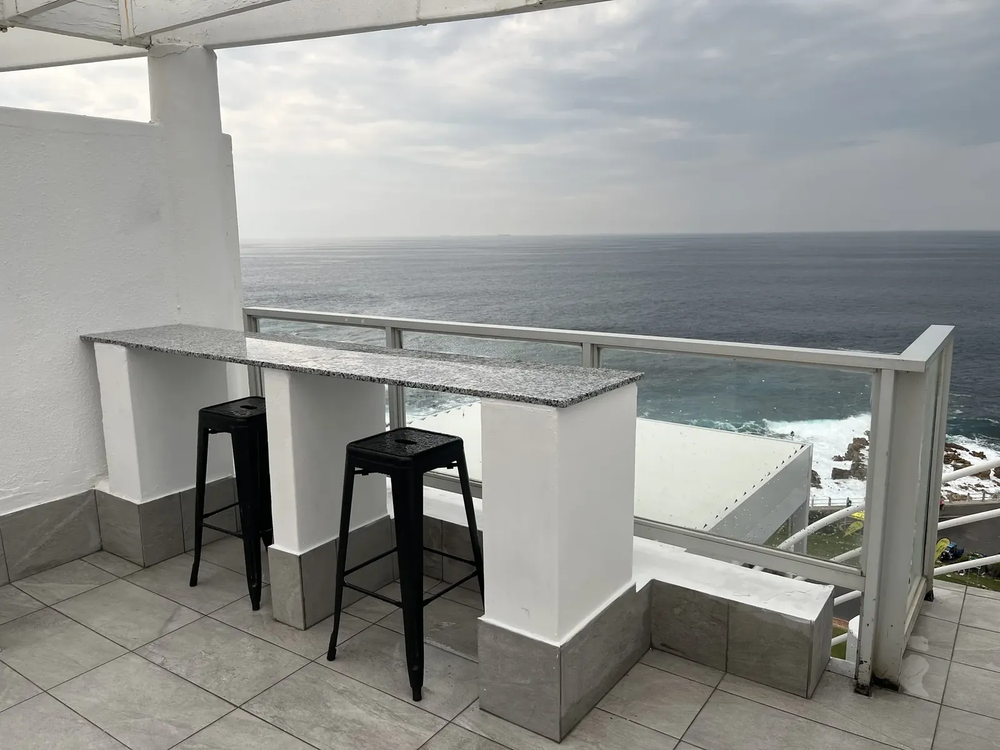

# NS Smart website

The website for **NS Smart**, a Cape Town renovation and construction contractor.
*Smart spaces. Delivered at speed.*

- **Preview (GitHub Pages):** https://abdul-s1.github.io/company-website/
- **Live site:** https://nssmart.co.za (hosted on Xneelo)

The site is plain HTML, CSS and JavaScript. There is **no build step**: what you see
in this folder is exactly what gets uploaded.

---

## Where to find everything

```
company-website/
├── index.html                 Home page
├── services.html              Services
├── projects.html              Our Work (project rows, full gallery, catalogue)
├── about.html                 About
├── quotation.html             Request a Quote
│
├── NS_Smart_Renovation_Catalogue.pdf   The catalogue (keep this exact name and place)
├── logo.png  favicon.png      Logo and browser icon (kept at the top level because
│                              search engines and social previews link to these addresses)
├── robots.txt  sitemap.xml    For search engines
│
├── tools/
│   └── prepare-photos.py      Turns camera photos into web-ready .webp files
│                              (for your computer only; don't upload it)
│
└── assets/
    ├── css/
    │   ├── base.css           Brand colours, fonts, type sizes, spacing (start here)
    │   ├── layout.css         Glass header with logo, phone menu, page titles, footer
    │   ├── components.css     Buttons, links, before/after slider, marquee,
    │   │                      contact block, floating contact button, image viewer,
    │   │                      scroll entrances
    │   └── pages/             One file per page, only loaded by that page
    │       ├── home.css  services.css  projects.css  about.css  quotation.css
    │
    ├── js/
    │   ├── main.js            Footer year, floating contact button, gallery
    │   │                      filters and image viewer
    │   ├── nav.js             Phone menu
    │   ├── reveal.js          Scroll entrances + the zoom section on the home page
    │   ├── showreel.js        Home hero: photo window with the timer bar
    │   └── slider.js          The before/after comparison slider
    │
    ├── fonts/                 Inter and Poppins (self-hosted, with their licences)
    └── images/
        ├── brand/             Logo pieces (header logo, opening animation)
        └── projects/          One folder per project, numbered photos inside
            ├── room-803-deck/         the flagship rooftop deck
            ├── 9th-floor-lobby/  buffet-cladding/  timber-slat-wall/
            ├── ceilings/  ceilings-foyer/  gym/
            ├── lift-lobby/  suite-bathroom/   before/after pairs
            └── bathroom-gallery/      completed-01 … completed-06
```

### Common changes

| I want to… | Go to |
| --- | --- |
| Change a colour or font size everywhere | `assets/css/base.css`, section 2 "Design tokens" |
| Change a phone number or email | Search all `.html` files for the old number and replace it |
| Edit the menu | The `<nav class="main-nav">` block near the top of each page, and the footer menu at the bottom |
| Swap any photo | See **Swapping photos** below |
| Change the showreel speed | `REEL_TIME` at the top of `assets/js/showreel.js` |

Each file starts with a short comment that says what it does, and the HTML uses
comments like `<!-- ===== Hero ===== -->` to mark each section.

### How the before/after slider works

`assets/js/slider.js` looks for any element with `data-compare`. The "after" photo
sits underneath and the "before" photo is laid on top and cropped. You can move it:

- **Mouse:** click or drag anywhere on the photo.
- **Touch:** drag sideways. Swiping up or down still scrolls the page.
- **Keyboard:** Tab to the round handle, then use the arrow keys (hold Shift for bigger
  steps), Page Up/Down, Home and End.

Visitors who have asked their device for reduced motion get no animations anywhere
on the site.

---

## Swapping photos

Every photo on the site is **one file** and **one line** of HTML. The shape of each
photo on the page is set by the CSS, so a new photo of a different size or shape just
fills the same space. You never have to edit sizes.

**1. Prepare the photo.** Put your new photos in any folder on your computer and run:

```bash
python tools/prepare-photos.py "C:/path/to/new photos" assets/images/projects/my-project
```

This shrinks them, turns them the right way up, removes hidden GPS data and saves them
as `.webp`. (Want to keep it simpler? A `.jpg` works too. It's just a bigger file.)

**2. Point the page at it.** Find the old file name in the table below, open that
page's `.html` file, search for the file name and replace it with the new one.
Also update the `alt="..."`: one sentence saying what the photo shows (people using
screen readers and Google read it).

**Or: keep the same name.** Save your new photo over the old file with exactly the
same name, and nothing in the code changes at all.

### The home page showreel

The showreel is the list of `` lines in `index.html`,
right under the comment "HOW TO CHANGE THE SHOWREEL PHOTOS". Each line is one photo:

```html

```

- `src`: the photo (landscape photos look best)
- `data-title`: the short caption in the glass pill
- `alt`: a sentence describing the photo

Copy a line to add a photo, delete a line to remove one, move lines to change the
order. The timer bar adjusts itself.

### Before/after sliders

Each slider is a `data-compare` block with two photos: the **after** photo first,
then the **before** photo inside `compare__before`. Use two photos taken from the same
spot. The home page slider also has a portrait pair for phones (the `<source ...>`
lines).

### Our Work: projects and the full gallery

- **Project rows:** each project is one `<article class="project">` block. To change
  its photo, edit the `` inside it. To add a project, copy a whole block.
  The rows swap sides automatically: give every second one the class `project--flip`.
- **Full gallery:** one line per photo:

  ```html
  <button class="gallery__item" type="button" data-project="room-803-deck"></button>
  ```

  `data-project` puts it under the right filter button (it must match a button's
  `data-filter`). Copy a line to add a photo, delete it to remove one.

### Where every photo is used

Paths below start from `assets/images/projects/`.

| Page | Section | Photo file |
| --- | --- | --- |
| Home | Hero showreel | `room-803-deck/01.webp` |
| Home | Hero showreel | `9th-floor-lobby/09.webp` |
| Home | Hero showreel | `buffet-cladding/03.webp` |
| Home | Hero showreel | `room-803-deck/15.webp` |
| Home | Hero showreel | `timber-slat-wall/01.webp` |
| Home | Hero showreel | `ceilings-foyer/04.webp` |
| Home | Hero showreel | `room-803-deck/30.webp` |
| Home | Hero showreel | `gym/02.webp` |
| Home | What we deliver | `9th-floor-lobby/08.webp` |
| Home | What we deliver | `buffet-cladding/04.webp` |
| Home | What we deliver | `gym/08.webp` |
| Home | What we deliver | `room-803-deck/04.webp` |
| Home | Before and after (phone version) | `suite-bathroom/after-02.webp` |
| Home | Before and after | `lift-lobby/after-02.webp` |
| Home | Before and after (phone version) | `suite-bathroom/before-02.webp` |
| Home | Before and after | `lift-lobby/before-01.webp` |
| Home | Close-up showcase | `room-803-deck/18.webp` |
| Home | Working in open hotels | `9th-floor-lobby/10.webp` |
| Home | Contact call to action | `room-803-deck/06.webp` |
| Services | Page hero | `lift-lobby/after-02.webp` |
| Services | Core services | `bathroom-gallery/completed-03.webp` |
| Services | Core services | `lift-lobby/after-01.webp` |
| Services | Core services | `suite-bathroom/after-01.webp` |
| Services | Core services | `bathroom-gallery/completed-06.webp` |
| Services | How we work | `lift-lobby/before-02.webp` |
| Services | How we work | `suite-bathroom/before-01.webp` |
| Services | How we work | `bathroom-gallery/completed-04.webp` |
| Services | How we work | `bathroom-gallery/completed-02.webp` |
| Services | How we work | `lift-lobby/after-01.webp` |
| Our Work | Projects | `room-803-deck/01.webp` |
| Our Work | Projects | `lift-lobby/after-02.webp` |
| Our Work | Projects | `lift-lobby/before-01.webp` |
| Our Work | Projects | `suite-bathroom/after-02.webp` |
| Our Work | Projects | `suite-bathroom/before-02.webp` |
| Our Work | Projects | `buffet-cladding/03.webp` |
| Our Work | Projects | `timber-slat-wall/01.webp` |
| Our Work | Projects | `ceilings-foyer/04.webp` |
| Our Work | Projects | `gym/02.webp` |
| Our Work | Catalogue download | `room-803-deck/15.webp` |
| Our Work | Catalogue download | `9th-floor-lobby/08.webp` |
| Our Work | Catalogue download | `bathroom-gallery/completed-05.webp` |
| About | Page hero | `bathroom-gallery/completed-02.webp` |
| About | Our company | `lift-lobby/after-01.webp` |
| About | Photo strip | `bathroom-gallery/completed-03.webp` |
| About | Photo strip | `lift-lobby/after-02.webp` |
| About | Photo strip | `suite-bathroom/after-01.webp` |
| Request a Quote | Recent work | `lift-lobby/after-02.webp` |
| Request a Quote | Recent work | `bathroom-gallery/completed-05.webp` |
| Request a Quote | Recent work | `bathroom-gallery/completed-01.webp` |
| Request a Quote | Recent work | `lift-lobby/after-01.webp` |
| Our Work | Full gallery | 48 photos, one line each, in `projects.html` under "Full gallery" |

---

## Uploading to Xneelo

1. Log in to the Xneelo control panel and open **File Manager** for nssmart.co.za
   (or connect with an FTP program such as FileZilla).
2. Open the `public_html` folder.
3. Upload these files and folders, replacing what is there:
   - `index.html`, `services.html`, `projects.html`, `about.html`, `quotation.html`
   - the whole `assets` folder
   - `logo.png`, `favicon.png`, `robots.txt`, `sitemap.xml`
   - `NS_Smart_Renovation_Catalogue.pdf`
4. **Don't upload** `README.md`, `.gitignore`, the `tools` folder, the `.git` folder,
   or a `.taste-skill` or `.claude` folder.
5. Optional tidy-up: the old site had loose files in `assets/css/` (`site.css`,
   `home.css`, …), `assets/js/` (`site.js`, `projects.js`) and flat images in
   `assets/images/projects/` (`completed-bathroom-01.webp`, …). The new site doesn't
   use them, so you can delete them from the server once the new pages are live.
6. Open https://nssmart.co.za in a private window and check every page on your
   computer and your phone.

## Previewing changes

Push to the `main` branch on GitHub and the preview at
https://abdul-s1.github.io/company-website/ updates within a minute or two.
To preview locally, open `index.html` in a browser.

## Ground rules

- This repository is **public**. Never add pricing, financial details, private notes or
  any photo marked "do not publish" in the photo index.
- Only use real project photos, never stock or AI-generated ones.
- Keep the page file names, the catalogue address and the `<head>` tags (titles,
  descriptions, canonical links, structured data). Search engines rely on them.
